# Diário de Bordo — Projeto Flutter (Faculdade)

Este repositório é o registro de tudo que vamos fazendo no projeto Flutter da
faculdade (`flutter_dart`): decisões tomadas, comandos rodados, prompts usados
com IA e prints das telas. A ideia é ir anotando aqui no dia a dia; depois dá
pra transformar isso num template mais bonito.

Cada entrada nova fica em ordem cronológica (mais recente por último), com
data, o que foi feito, como foi feito (incluindo uso de IA) e, quando possível,
imagem.

---

## 25/08 e 26/08/2026

**O que foi feito:** criação do repositório `flutter_dart` no GitHub e
configuração da proteção da branch `main`, antes de qualquer código entrar
no projeto.

**Como foi feito:**
- Criei o repositório `flutter_dart` na conta `Pedro-Martins-Nascimento`
  (público, sem README/gitignore automáticos).
- Fiz o primeiro commit do projeto pelo VS Code ("setup inicial do
  projeto Flutter").
- Configurei o `.gitignore` pra não versionar arquivos sensíveis do
  Firebase (`android/app/google-services.json`,
  `ios/Runner/GoogleService-Info.plist`, `lib/firebase_options.dart`),
  já preparando pra quando a integração com Firebase entrar na N2.
- Criei uma **ruleset** (`main-protection`) pra branch `main`, em vez da
  branch protection clássica:
  - exige Pull Request antes de qualquer merge (sem push direto);
  - exige 1 aprovação de review antes de mergear;
  - permite só **squash merge** (desabilita merge commit e rebase);
  - bloqueia force push e restringe quem pode apagar a branch.

**Resultado:** repositório criado e protegido desde o início — toda
mudança na `main` passa obrigatoriamente por PR revisada. Essa regra
acabou travando alguns merges nos dias seguintes (ver entrada de
04/09/2026), mas era exatamente o comportamento configurado aqui.

**Imagens:**

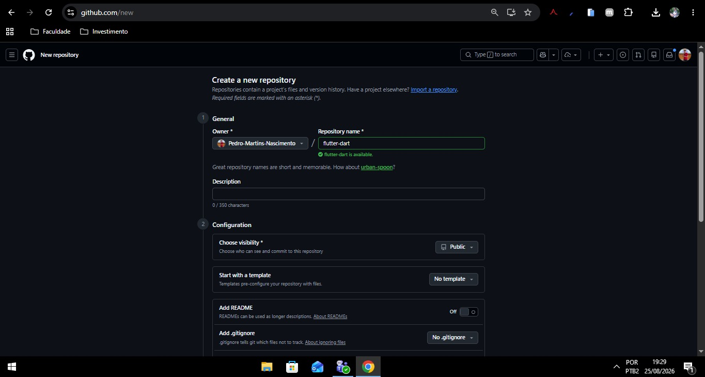
*Criação do repositório no GitHub*

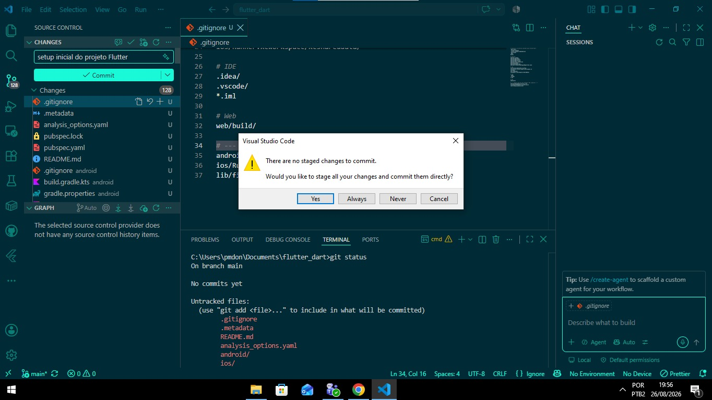
*Primeiro commit pelo VS Code*

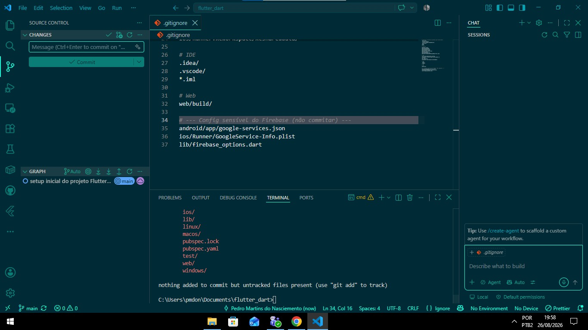
*`.gitignore` com exclusão da config sensível do Firebase*

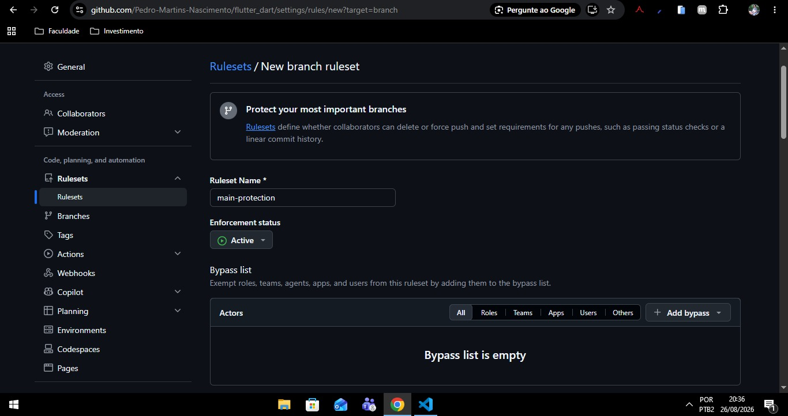
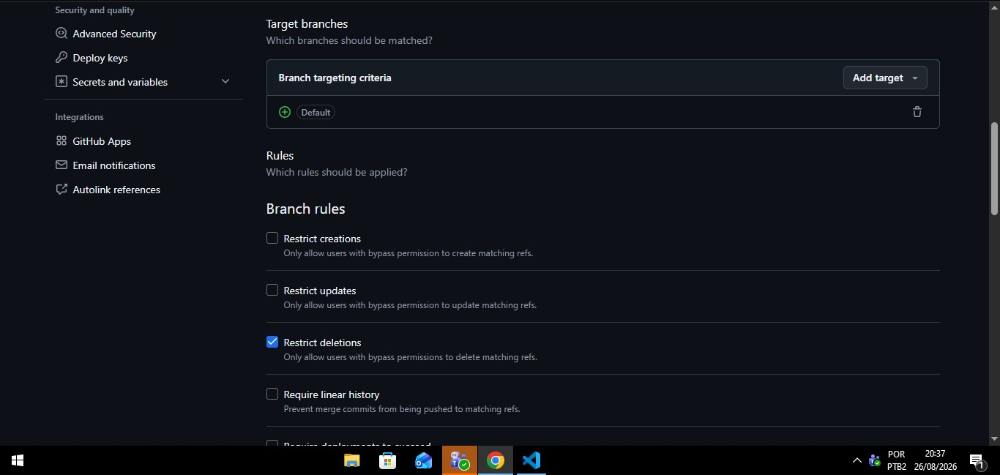
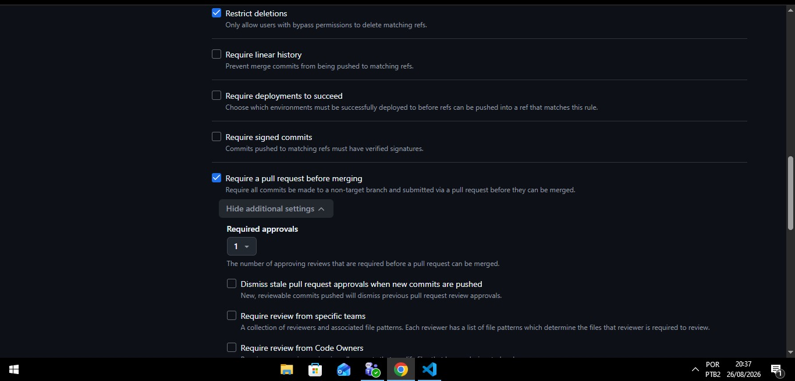
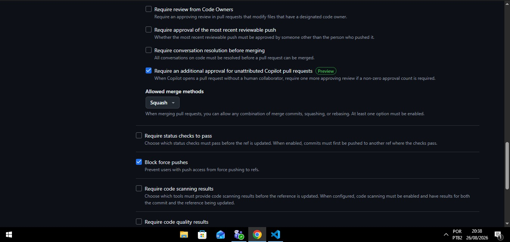
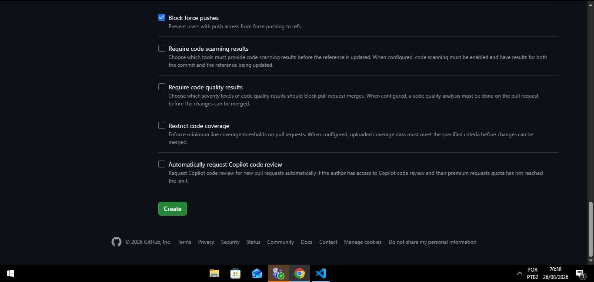
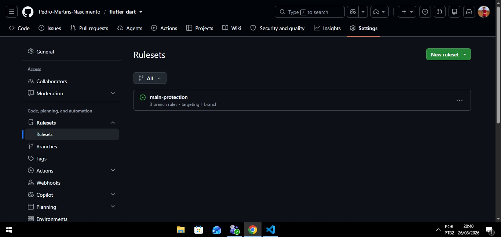
*Passo a passo da criação da ruleset `main-protection` (PR obrigatória, 1
aprovação, squash-only, bloqueio de force push)*

---

## 29/08/2026

**O que foi feito:** limpeza geral do projeto Flutter recém-criado
(`flutter_dart`), que estava com a estrutura padrão gerada pelo
`flutter create`.

**Como foi feito:**
- Usei o Claude Code (assistente de IA) para revisar o repositório.
- Rodei `flutter analyze` e `flutter test` pra confirmar que o projeto padrão
  não tinha nenhum erro antes de mexer em qualquer coisa.
- Pedi para remover os comentários de tutorial que o Flutter gera
  automaticamente em `lib/main.dart`, `test/widget_test.dart` e
  `pubspec.yaml`, mantendo só o código funcional.
- Atualizei a descrição do `pubspec.yaml` e o `README.md` do projeto
  (`flutter_dart`) para refletir que é um projeto da faculdade.
- Rodei `flutter analyze` e `flutter test` de novo depois das mudanças pra
  garantir que nada quebrou.

**Resultado:** projeto `flutter_dart` mais limpo, sem comentários de
boilerplate, com `flutter analyze` e `flutter test` passando 100%.

**Imagens:**

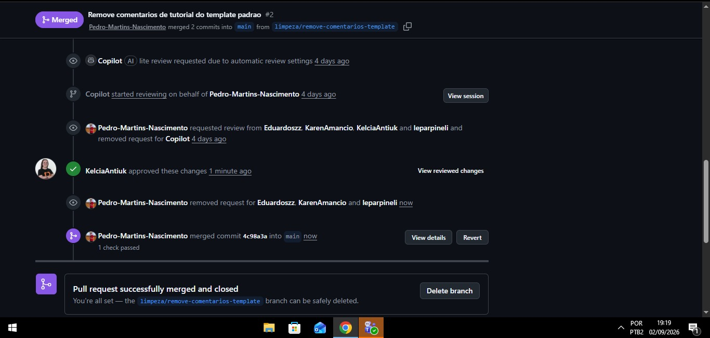
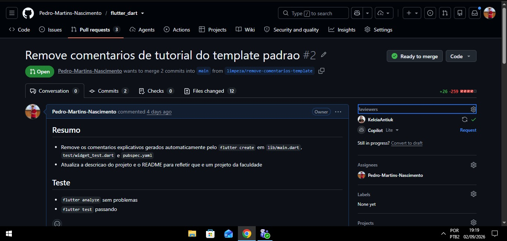
*Merge da PR #2, que entregou essa limpeza (os prints são de 02/09; o
trabalho local foi feito em 29/08, mas a PR só foi mergeada no GitHub
alguns dias depois)*

---

## 03/09/2026

**O que foi feito:** análise das Pull Requests abertas no repositório
`flutter_dart` para decidir a estratégia de merge (mergear tudo e depois
padronizar componentes, ou pedir pra cada pessoa arrumar antes de mergear).
Só análise — nenhuma PR foi mergeada ou alterada.

**Como foi feito:**
- Usei o Claude Code (assistente de IA) para listar e inspecionar as PRs
  abertas com `gh pr list` e `gh pr view <n> --json ...`.
- Comparei os branches com `git log origin/main..origin/<branch> --oneline`
  pra entender a cadeia de dependência entre as PRs.
- Simulei os merges com `git merge-tree $(git merge-base origin/main
  origin/feature/tela-provas) origin/main origin/feature/tela-provas` pra
  achar a causa exata do conflito, sem precisar fazer checkout de nada.

**Evidência (logs do git):**
```
$ gh pr list --state open
#5  Feature/main shell   feature/main-shell -> feature/tela-login   MERGEABLE
#4  Tela-Login           feature/tela-login -> feature/tela-provas  MERGEABLE
#3  banco de questoes... feature/questoes   -> main                CONFLICTING
#1  feat(provas)...      feature/tela-provas -> main               CONFLICTING

$ git log origin/main..origin/feature/tela-provas --oneline
29cb9dc feat(provas): fluxo completo de Criar Prova, Gerar Provas e exportação em PDF

$ git log origin/feature/tela-provas..origin/feature/questoes --oneline
38c9244 feat(questoes): banco de questoes com alternativas e gabarito

$ git log origin/feature/tela-provas..origin/feature/tela-login --oneline
8e93729 feat: added login
ce7f49a added new route
f5ed203 remove debug and update comment

$ git log origin/feature/tela-login..origin/feature/main-shell --oneline
256bd32 feat: added em breve
7336950 feat: added bottom nav
0ad62d5 feat: added main shell
daa19df feat: new routes
```
O `git merge-tree` mostrou que o conflito de #1 e #3 é só em `lib/main.dart`:
a limpeza de comentários já feita em `main` (commit `4c98a3a`) mexeu no mesmo
trecho que a #1 reescreveu para usar `MaterialApp.router`.

**Resultado:** as PRs não são independentes, formam uma cadeia:
`main` ← `tela-provas` (#1) ← `tela-login` (#4) ← `main-shell` (#5), com
`questoes` (#3) derivada de `tela-provas` mas mirando `main` direto (por
isso já carrega o commit da #1 dentro dela). Também achei uma branch órfã
`feature/tela-turmas` sem PR aberta.

Decidido: mergear na ordem certa primeiro (resolvendo o único conflito
pontual do `main.dart`) e só depois abrir uma tarefa de padronização de
componentes (tema, cards, navegação) — em vez de pedir pra cada autor
arrumar em paralelo, o que geraria mais rebase e mais conflito com os
branches se movendo. Ordem definida:
1. Resolver conflito de `main.dart` e mergear #1 (`tela-provas`).
2. Reapontar #3 (`questoes`) pra `main` e mergear.
3. Reapontar #4 (`tela-login`) pra `main` e mergear.
4. Reapontar #5 (`main-shell`) pra `main` e mergear.
5. Abrir PR única de padronização em cima do que já estiver consolidado.

**Também nesse dia:** aprovada a PR #6 (`docs: register project decisions
and notes`), que organizou a documentação do projeto em
`docs/correcao-de-provas-docs.md` — levantamento do cliente, RFs/RNFs,
fases N1/N2/N3 e o protótipo visual em HTML (`docs/appProvas.html`) — e
que serviu de base pra este diário de bordo.

**Imagens:**

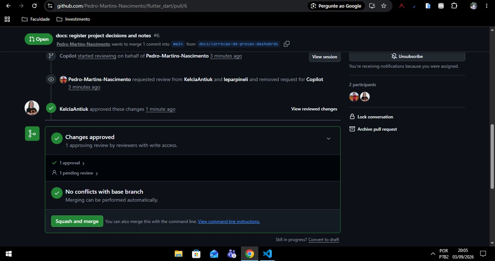
*PR #6 aprovada por `KelciaAntiuk`, pronta pra squash merge*

---

## 04/09/2026

**O que foi feito:** merge das PRs abertas do `flutter_dart` (banco de
questões, login e main-shell) seguindo a ordem decidida no dia 03/09,
resolvendo os conflitos reais encontrados no caminho.

**Como foi feito:**
- Usei o Claude Code para trocar a conta ativa do GitHub CLI
  (`gh auth switch`) para a conta dona do repositório
  (`Pedro-Martins-Nascimento`) antes de mexer nas PRs.
- Mergeei a PR #4 (Tela-Login) com `gh pr merge --merge`. Só depois percebi
  que a PR estava aberta contra `feature/tela-provas` como base (não
  `main`) — o merge foi real, mas não chegou na `main` diretamente. Isso
  também fechou a PR #5 sozinha, porque o GitHub fecha automaticamente
  uma PR quando a branch base dela é apagada (e o `--delete-branch` do
  merge da #4 apagou `feature/tela-login`, que era a base da #5).
- Recriei a PR #5 como uma nova PR (#7), agora com base certa (`main`).
  Como a branch `feature/main-shell` já continha os commits do login (era
  empilhada em cima de `feature/tela-login`), o conteúdo do login acabou
  chegando na `main` por essa PR mesmo assim.
- Resolvido o conflito de merge entre `feature/main-shell` e `main` em
  `lib/main.dart` e `lib/router/app_router.dart` — histórico divergente,
  já que `feature/main-shell` foi criada antes do squash-merge da PR #1.
  Mantida a versão mais completa (login + shell com bottom nav + rotas de
  provas).
- Atualizei o smoke test (`test/widget_test.dart`), que checava a tela de
  Criar Prova como tela inicial — ele já tinha um TODO anotado pra isso,
  então troquei pra verificar a tela de Login.
- Resolvido o conflito da PR #3 (banco de questões) em 5 arquivos
  (`app_router.dart`, `criar_prova_screen.dart`, `gerar_provas_screen.dart`,
  `preview_layout_screen.dart`, `pdf_service.dart`). Comparei os dois lados
  do conflito com `git diff origin/main:<arquivo> feature/questoes:<arquivo>`
  e confirmei que a versão da branch `feature/questoes` era uma evolução
  da que já estava na `main` (trocava os dados mock pelo modelo `Questao`
  real, com alternativas e gabarito) — então mantive essa versão.
- Rodei `flutter analyze` e `flutter test` depois de cada merge de
  conflito, antes de subir (`git push`), pra garantir que nada quebrou.
- Descobri que o repositório tem uma **ruleset** na `main` exigindo 1
  review aprovada e permitindo só squash merge — nem `gh pr merge --admin`
  contorna isso. Pedi review pra `KelciaAntiuk` nas PRs #7 e #3.
- As PRs #3 e #7 foram aprovadas: uma foi aprovada por mim e a outra, que
  era de minha autoria, recebeu aprovação da revisão.
- Cheguei a criar uma PR de diário de bordo dentro do próprio repositório
  `flutter_dart` (`docs/diario-de-bordo.md`), mas o diário de bordo é essa
  pasta local mesmo — fechei a PR e apaguei o arquivo/branch de lá.

**Resultado:** PRs #7 (main-shell + login) e #3 (banco de questões)
foram aprovadas e estavam prontas para mergear com squash, com
`flutter analyze` sem apontamentos e `flutter test` passando. PR #4 ficou
registrada como "merged" no GitHub, mas mergeada em `feature/tela-provas`
em vez de `main` — sem efeito prático, porque o conteúdo dela chega na
`main` de qualquer forma pela #7, mas fica esse detalhe no histórico do
GitHub pra quem for conferir depois.

**Imagens:**

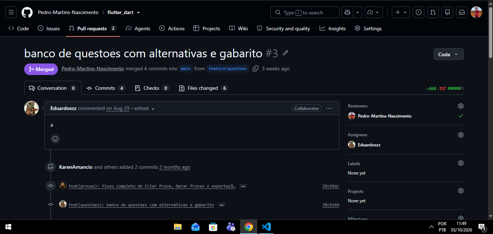
*Aprovacao da PR #3.*

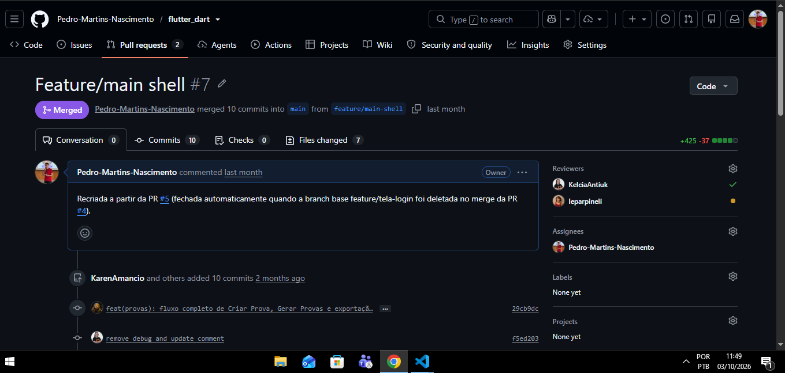
*Aprovacao da PR #7.*

---

## 08/09/2026

**O que foi feito:** troca da conta ativa do GitHub CLI, merge da PR #9
(`feature/tela-provas`) na `main`, e início da análise da PR #3 (banco de
questões), que foi interrompida por ter um conflito de lógica de negócio
real — decisão de como resolver ficou pendente.

**Como foi feito:**
- Usei o Claude Code para trocar a conta ativa do `gh` de `pedron-martins`
  para `Pedro-Martins-Nascimento` (`gh auth switch`), dona do repositório
  `flutter_dart`.
- Revisei a PR #9 (`feature/tela-provas` → `main`, autora `KarenAmancio`):
  fiz checkout, mergeei `main` na branch e resolvi um conflito pontual em
  `lib/router/app_router.dart` (a branch ainda tinha rotas soltas de
  `/criar-prova` e `/gerar-provas` fora do shell; a `main` já tinha
  migrado essas rotas pra dentro da `StatefulShellRoute` com bottom nav —
  mantive a estrutura de shell da `main` e preservei o tratamento de
  `ProvaGerada`/histórico que a PR trazia).
- Rodei `flutter analyze` (sem apontamentos) e `flutter test` (1/1
  passando) depois do merge, antes de subir.
- Tentei `gh pr merge --merge` e esbarrei de novo na ruleset da `main`
  (ver 25/08): exige review aprovada. Diferente do dia 04/09, dessa vez
  aprovei a PR eu mesmo pelo `gh pr review --approve` (com o resultado da
  validação no corpo da aprovação) antes de mergear.
- `gh pr merge --merge` falhou de novo, mas com um motivo novo: "Merge
  commits are not allowed on this repository" — a ruleset permite **só
  squash merge** (como já estava documentado na entrada de 25/08, mas eu
  tinha esquecido na hora). Troquei pra `gh pr merge --squash` e mergeou.
- Comecei a mesma sequência na PR #3 (`feature/questoes` → `main`, autor
  `Eduardo`): atualizei a `main` local (trouxe o squash da #9) e dei
  `gh pr checkout 3` + merge da `main` na branch.
- O merge da PR #3 gerou conflito real (não só cosmético) em 5 arquivos:
  `app_router.dart`, `criar_prova_screen.dart`, `gerar_provas_screen.dart`,
  `preview_layout_screen.dart` e `pdf_service.dart`. A causa: a `main`
  (via PR #9) evoluiu "Criar Prova" com nome da prova, seleção de turma e
  histórico de provas geradas (`DadosProva`), enquanto a `feature/questoes`
  trocou o banco mock simples por um modelo real em `lib/models/questao.dart`
  (`Questao` com `alternativas` e `respostaCorreta`, banco com 8 matérias e
  48 questões) e passou a montar o PDF com o conteúdo real das questões em
  vez do texto placeholder que a `main` ainda usava.
- Cheguei a montar uma proposta de resolução (unir o modelo real de
  questões da #3 com a UI de turma/nome/histórico da #9), mas fui
  interrompido antes de aplicar — recebi instrução pra não mexer mais na
  PR #3 por agora e priorizar esse registro no diário.
- Abortei o merge em andamento (`git merge --abort`) na branch
  `feature/questoes` pra não deixar a branch remota nem o repositório
  `flutter_dart` com nada pela metade.

**Resultado:** PR #9 mergeada na `main` (squash). PR #3 segue aberta e
sem alterações — o merge de teste foi desfeito, o conflito real entre os
dois modelos de questões (mock simples com turma/nome vs. modelo real com
alternativas/gabarito) ainda precisa ser decidido antes de retomar.

**Imagens:**

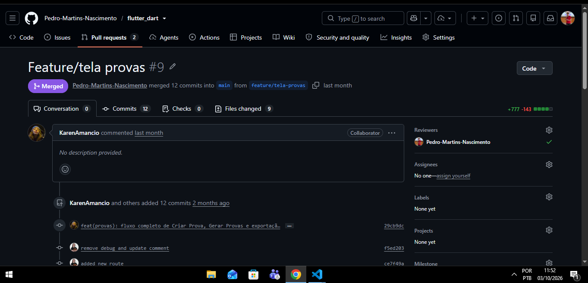
*PR #9 aprovada e mergeada.*

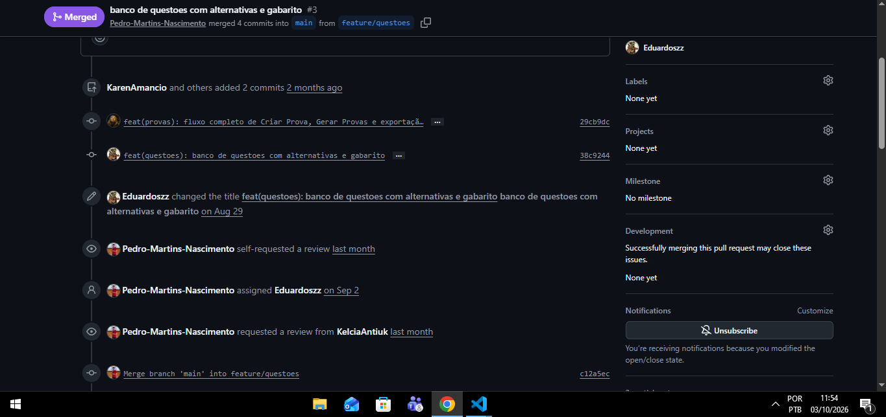
*Primeiro registro do conflito da PR #3.*

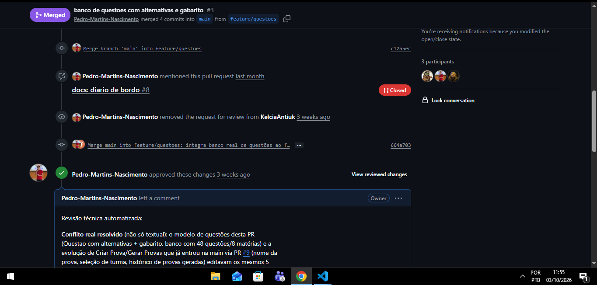
*Segundo registro do conflito da PR #3.*

---

## 10/09/2026

**O que foi feito:** troca da conta ativa do GitHub CLI e merge da PR #11
(`feature/tela-turmas`, autora Letícia Parpineli — telas de Turmas) na
`main`, sem abrir PR nova.

**Como foi feito:**
- Usei o Claude Code para trocar a conta ativa do `gh` de `pedron-martins`
  para `Pedro-Martins-Nascimento` (`gh auth switch`), dona do repositório.
- Revisei a PR #11 (`feature/tela-turmas` → `main`): checkout via
  `gh pr checkout 11`. A branch já estava sincronizada com a `main` (merge
  anterior no commit `b286c55`), então não houve conflito nenhum pra
  resolver dessa vez.
- Entrega da PR: telas de listar/criar/visualizar turma
  (`criar_turma_screen.dart`, `visualizar_turma_screen.dart`) e importação
  de lista de alunos via CSV/XLSX (`importar_alunos_screen.dart`, com os
  pacotes novos `file_picker` e `excel`), além das rotas correspondentes
  em `app_router.dart` — cobre RF03, RF04 e RF05 do escopo da N1, ainda
  com dados mock (sem persistência real), como esperado nessa fase.
- Rodei `flutter pub get`, `flutter analyze` (sem apontamentos) e
  `flutter test` (1/1 passando) antes de decidir mergear.
- Como não havia review na PR, aprovei eu mesmo com `gh pr review
  --approve` (registrando o resultado da validação no corpo), do mesmo
  jeito que na entrada de 08/09 — a ruleset da `main` exige 1 aprovação
  antes do merge.
- `gh pr merge --squash` (a ruleset só permite squash merge, como já
  registrado em 25/08 e 08/09) — mergeou de primeira dessa vez.
- No VS Code local sobrou uma alteração não commitada em
  `macos/Flutter/GeneratedPluginRegistrant.swift` (arquivo que o Flutter
  regenera sozinho a cada `pub get` quando há dependência nova). Conferi
  com `git diff` e era só troca de fim de linha (LF → CRLF, efeito do
  ambiente Windows) — descartei com `git restore` em vez de commitar.

**Resultado:** PR #11 mergeada na `main` (squash), sem precisar de PR
nova. `main` local atualizada via fast-forward.

**Também nesse dia — resolução da PR #3 (banco de questões, autor Eduardo):**
esse era o conflito real deixado pendente desde 08/09 (ver entrada acima).

- Fiz checkout da PR #3 (`gh pr checkout 3`) e trouxe a `main` atualizada
  (já com #7, #9 e #11) pra dentro da branch com `git merge origin/main`.
- O merge reabriu o mesmo conflito de 5 arquivos já mapeado em 08/09:
  `app_router.dart`, `criar_prova_screen.dart`, `gerar_provas_screen.dart`,
  `preview_layout_screen.dart`, `pdf_service.dart`. Causa: o modelo de
  questões da PR (`Questao` com alternativas e gabarito, banco com 48
  questões/8 matérias, em `lib/models/questao.dart`) e a evolução de
  "Criar Prova"/"Gerar Provas" que a PR #9 já tinha trazido pra `main`
  (nome da prova, seleção de turma, histórico via `ProvasRepository`)
  editavam os mesmos pontos de formas incompatíveis.
- Decisão de integração (a que ficou em aberto em 08/09): manter a
  estrutura de tela mais evoluída da `main` (nome da prova, turma,
  histórico) e enxertar nela o banco real de questões da PR. Na prática:
  - `criar_prova_screen.dart` passou a puxar matérias/questões de
    `lib/models/questao.dart` em vez do mock local simples (sem
    alternativas) que a `main` ainda tinha.
  - Aproveitei pra unificar o modelo de `Turma` local (duplicado nessa
    tela) com o `Turma` real do módulo de turmas (`criar_turma_screen.dart`,
    da PR #11) — turma criada ali passa a aparecer em "Minhas Turmas"
    também, em vez de sumir numa lista mock isolada.
  - `gerar_provas_screen.dart` ganhou de volta a lógica de embaralhamento
    por versão que só existia na PR (`QuestaoNaVersao`: alternativas
    reordenadas e `respostaCorreta` recalculado por versão — o gabarito
    de cada versão), mantendo o cabeçalho completo (nome/turma/professor/
    histórico) que a `main` já tinha.
  - `pdf_service.dart` e `preview_layout_screen.dart`: mantidos os
    controles de layout (fonte/espaçamento/margem) da `main`, mas o PDF
    passou a imprimir o enunciado e as alternativas de texto reais de
    cada questão — antes disso o PDF da `main` só tinha um enunciado mock
    fixo com bolinhas vazias A/B/C/D, sem gabarito de verdade nenhum.
- Rodei `flutter analyze` (sem apontamentos) e `flutter test` (1/1)
  depois de resolver os 5 arquivos.
- Testei o fluxo completo manualmente rodando o app no navegador
  (`flutter run -d web-server`, controlado via extensão Claude em Chrome):
  criei uma prova de Matemática vinculada à turma real "3º ano B —
  Matutino", selecionei 3 questões do banco, gerei 3 versões e abri o
  Editor de layout — o PDF gerado mostrou o enunciado e as alternativas
  reais de cada questão, com a ordem das alternativas (e portanto o
  gabarito) diferente entre versões, confirmando o embaralhamento.
- Como não havia review, aprovei eu mesmo (`gh pr review --approve`) com
  um relatório detalhado da resolução do conflito no corpo — mesmo com
  autonomia total pra decidir, deixei a decisão de design registrada na
  PR pro Eduardo revisar depois. Mergeei com `gh pr merge --squash`
  (mesma ruleset das outras), sem abrir PR nova.

**Resultado:** PR #3 mergeada na `main` (squash). O banco real de
questões (alternativas + gabarito) está integrado ao fluxo de Criar
Prova → Gerar Provas → Exportar PDF, com gabarito recalculado por versão
e turma unificada com o módulo de Turmas. `main` local atualizada via
fast-forward.

**Também nesse dia — revisão e merge da PR #12 (`feat/corrigir`, autora
KelciaAntiuk):** entrega grande, sem conflito de merge com a `main`
(a branch já estava sincronizada), mas que precisou de uma correção antes
de mergear.

- Fiz checkout da PR #12 (`gh pr checkout 12`); `git merge origin/main`
  não teve nada a fazer — a branch já estava com #3, #7, #9 e #11
  incorporados.
- Escopo entregue: banco de questões com CRUD completo (Matérias →
  Questões → Formulário de questão, cobrindo RF06/RF07 que ainda
  faltavam), dashboard real na tela de Início (corrigidas/pendentes/
  média, erro por matéria, últimas provas — usando `ChangeNotifier` no
  `ProvasRepository`), tela de Corrigir com leitura de QR via câmera
  (pacote `mobile_scanner`, RF13/RF14), e navegação responsiva (sidebar
  em telas largas, bottom nav em estreitas). Também relaxou o modelo
  `Questao` pra aceitar de 2 a 8 alternativas (antes travado em
  exatamente 4), pra combinar com o novo formulário.
- **Achado sério antes de validar:** um dos commits da própria PR
  (`chore(testes): remove os arquivos de teste`) apagava o único arquivo
  de teste do projeto (`test/widget_test.dart`) inteiro, sem nenhum
  substituto e sem justificativa no corpo do commit. Recuperei o
  conteúdo de antes desse commit (`git show <commit>~1:test/widget_test.dart`)
  e restaurei o arquivo — o smoke test da tela de Login continuou
  passando normalmente mesmo depois de todas as mudanças da PR.
- Revisei manualmente o código novo (não só rodei analyze/test): as 3
  telas do banco de questões, o router, `main.dart`, `login_screen.dart`
  (validação de e-mail/senha de verdade) e `provas_repository.dart`.
  Achado menor, não bloqueante: `_totalFolhas` (em `corrigir_screen.dart`
  e `inicio_screen.dart`) usa `turmasMock.first.qtdAlunos` — quebra com
  `StateError` se todas as turmas forem excluídas (caso extremo,
  registrado no comentário da PR pra próxima iteração, não corrigido
  agora).
- Rodei `flutter analyze` (sem apontamentos) e `flutter test` (com o
  teste restaurado, passando) depois da correção.
- Testei manualmente rodando o app no navegador: login com validação
  real, dashboard de Início, criei uma questão nova no banco (matéria
  Matemática) e confirmei que apareceu na listagem, e abri a tela de
  Corrigir (câmera solicitada corretamente, contador de folhas
  funcionando).
- Aprovei (`gh pr review --approve`) com relatório detalhado no corpo —
  citando explicitamente a remoção do teste corrigida e o achado menor
  pendente — e mergeei com `gh pr merge --squash`, sem abrir PR nova.

**Resultado:** PR #12 mergeada na `main` (squash), com o smoke test
restaurado. App ganhou banco de questões com CRUD completo, dashboard de
Início, correção por QR code (câmera) e navegação responsiva. `main`
local atualizada via fast-forward.

**Pendente:** tratar o caso de `turmasMock` vazio em `_totalFolhas`
(`corrigir_screen.dart` e `inicio_screen.dart`) com um fallback, em vez
de acessar `.first` direto.

**Também nesse dia — revisão e merge da PR #14 (`apk-readme`, autora
KelciaAntiuk):** README completo do projeto e ajuste de build para gerar
o APK Android.

- Fiz checkout da PR #14; `git merge origin/main` não teve nada a fazer
  (a branch já estava sincronizada via um merge anterior feito pela
  própria autora).
- **Mesmo problema do teste reapareceu:** essa branch (`apk-readme`) foi
  criada a partir de um ponto anterior à minha correção na PR #12. Quando
  a autora mesclou a `main` atualizada nela, o merge teve um conflito
  real de "deletado de um lado, modificado do outro" no
  `test/widget_test.dart` (a branch tinha a remoção antiga; a `main` já
  tinha meu conteúdo restaurado) — e a resolução manteve a remoção,
  reintroduzindo exatamente o mesmo problema. Restaurei o arquivo de novo
  (mesmo conteúdo de sempre).
- Revisei o `README.md` novo (rastreabilidade de RF/RNF, telas, como
  rodar, como gerar o APK, estrutura do projeto, equipe) e achei um bug
  de sintaxe: o link do vídeo de demonstração estava sem os parênteses do
  markdown (`[texto]url` em vez de `[texto](url)`), então não ficava
  clicável no GitHub — rastreei isso a dois commits da própria PR (um
  deixou um placeholder `(ADICIONAR-LINK-AQUI)` corretamente formatado, o
  seguinte trocou pelo link real mas perdeu os parênteses no meio do
  caminho). Corrigido.
- Revisei o `android/build.gradle.kts` novo: adiciona um bloco que força
  `compileSdkVersion=36` via reflection em qualquer subproject Android
  cuja versão configurada seja menor — workaround comum quando algum
  plugin (aqui, provavelmente o `mobile_scanner`) declara uma versão de
  SDK desatualizada. Não tenho Android SDK instalado nesta máquina, então
  não consegui rodar `flutter build apk --release` de fato para validar a
  geração do APK — registrei essa limitação no comentário da PR.
- Rodei `flutter analyze` (sem apontamentos) e `flutter test` (com o
  teste restaurado, passando) depois das duas correções.
- Aprovei com relatório detalhado citando as duas correções e a limitação
  de validação, e mergeei com `gh pr merge --squash`, sem abrir PR nova.

**Resultado:** PR #14 mergeada na `main` (squash). Projeto ganhou um
README completo e o ajuste de build necessário para compilar o APK
Android; smoke test seguiu restaurado e o link do vídeo corrigido.
`main` local atualizada via fast-forward.

**Pendente:**
- Mesmo pendente de antes: tratar `turmasMock` vazio em `_totalFolhas`.
- Gerar e testar o APK de verdade numa máquina com Android SDK instalado
  (esta máquina não tem — ver conversa sobre isso mais cedo no dia).
- Verificar se o vídeo de demonstração linkado no README (`youtu.be/ahXdrW6j_UQ`)
  está mesmo acessível/não listado, como o placeholder original pedia.

**Imagens:**

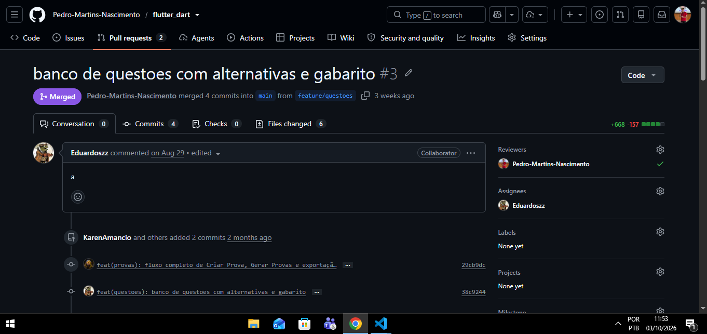
*Aprovacao da PR #3 pelo mantenedor.*

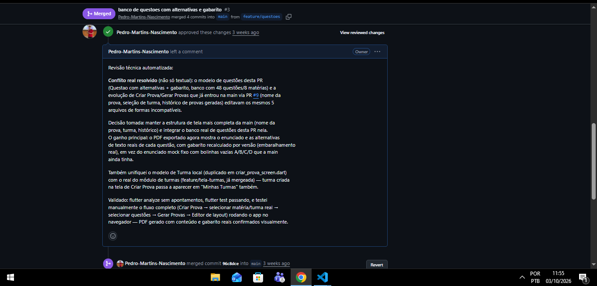
*Registro da resolucao tecnica do conflito da PR #3.*

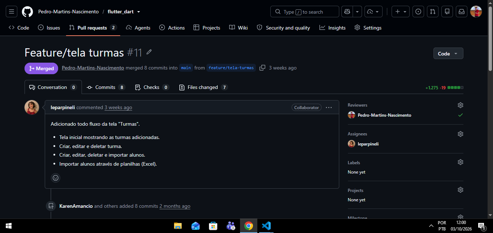
*Aprovacao da PR #11.*

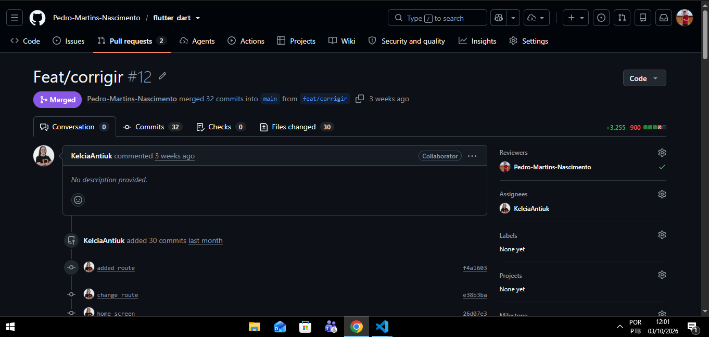
*Aprovacao da PR #12.*

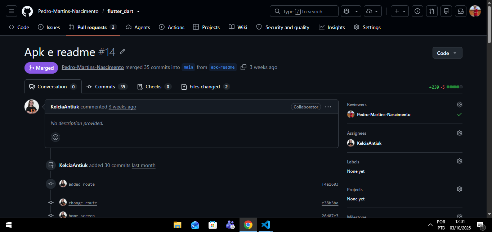
*Aprovacao da PR #14.*

---

## 03/10/2026

**O que foi feito:** refatoracao dos modelos de dominio usados no fluxo de
geracao de provas e abertura da PR #15.

**Como foi feito:**
- Atualizei a referencia local da `main` com as alteracoes remotas antes de
  reaplicar o trabalho local.
- Resolvi os conflitos mantendo as atualizacoes mais recentes da `main` e
  reaplicando a refatoracao dos modelos.
- Criei `lib/models/aluno.dart` com `Aluno` e `alunosMock`.
- Criei `lib/models/versao_prova.dart` com `QuestaoNaVersao` e `VersaoProva`,
  importando `Questao` de `lib/models/questao.dart`.
- Atualizei os imports em `app_router.dart`, `pdf_service.dart`,
  `provas_repository.dart`, `preview_layout_screen.dart` e
  `gerar_provas_screen.dart`.
- Criei a branch `refactor/modelos-dominio` baseada na `main` atualizada,
  fiz o commit `763efac` e publiquei a branch no GitHub.
- Abri a PR #15 contra `main`, solicitei revisao de `KelciaAntiuk` e ela foi
  aprovada e mergeada.
- Rodei `flutter analyze`, que terminou sem erros.

**Resultado:** PR #15 aprovada e mergeada na `main`. A branch ficou limpa,
alinhada com o remoto e sem alteracoes geradas de plataforma pendentes.

**Imagens:**

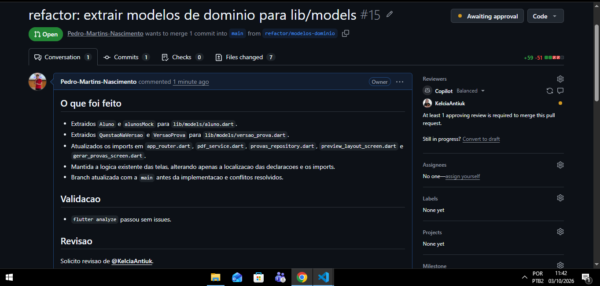
*PR #15 aberta no GitHub, com a revisao de `KelciaAntiuk` solicitada.*

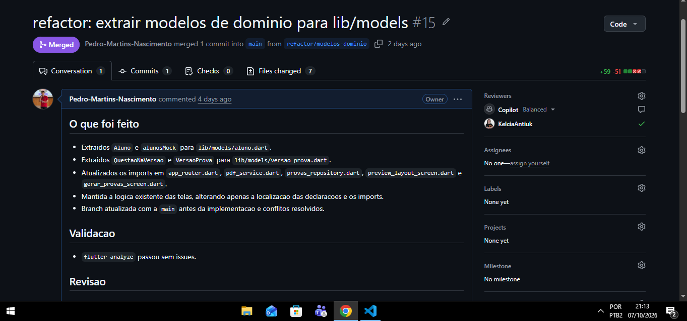
*PR #15 aprovada pela revisora e mergeada na `main`.*

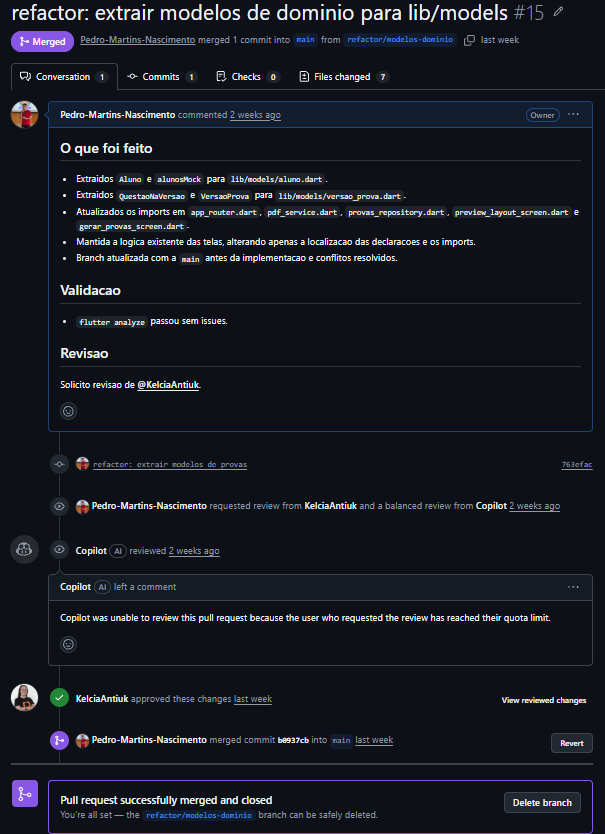
*Registro de aprovação e squash merge da PR #15.*

**Imagens que ainda faltam neste diario:**
- Entrada de `10/09/2026`: print do resultado da validacao do APK.

---

## 07/10/2026

**O que foi feito:** configuracao inicial do Firebase no projeto Flutter,
sem alterar telas ou regras de negocio existentes.

**Como foi feito:**
- Rodei `flutterfire configure`, que gerou `lib/firebase_options.dart`,
  `android/app/google-services.json` e `firebase.json`.
- Adicionei `firebase_core`, `firebase_auth` e `cloud_firestore` ao
  `pubspec.yaml` e rodei `flutter pub get`.
- Atualizei `lib/main.dart` para executar
  `WidgetsFlutterBinding.ensureInitialized()` e inicializar o Firebase com
  `DefaultFirebaseOptions.currentPlatform` antes do `runApp()`.
- Confirmei que o `.gitignore` ja cobre
  `lib/firebase_options.dart`, `android/app/google-services.json` e
  `ios/Runner/GoogleService-Info.plist`, evitando enviar configuracoes
  sensiveis ao GitHub.
- Rodei `flutter analyze`, que terminou sem issues.
- Rodei `flutter build web`; o build terminou com sucesso e gerou
  `build/web`. O dry-run de WebAssembly exibiu apenas avisos relacionados
  ao pacote `image`, sem impedir a compilacao Web.

**Resultado:** Firebase configurado para o projeto, dependencias resolvidas
e compilacao Web validada. Nenhuma tela ou logica existente foi alterada.

**Imagens:**

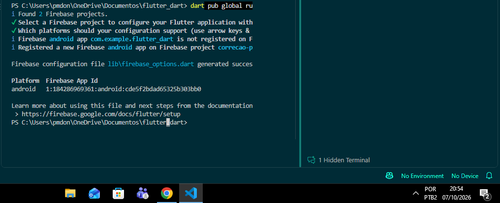
*Configuracao do projeto no Firebase.*

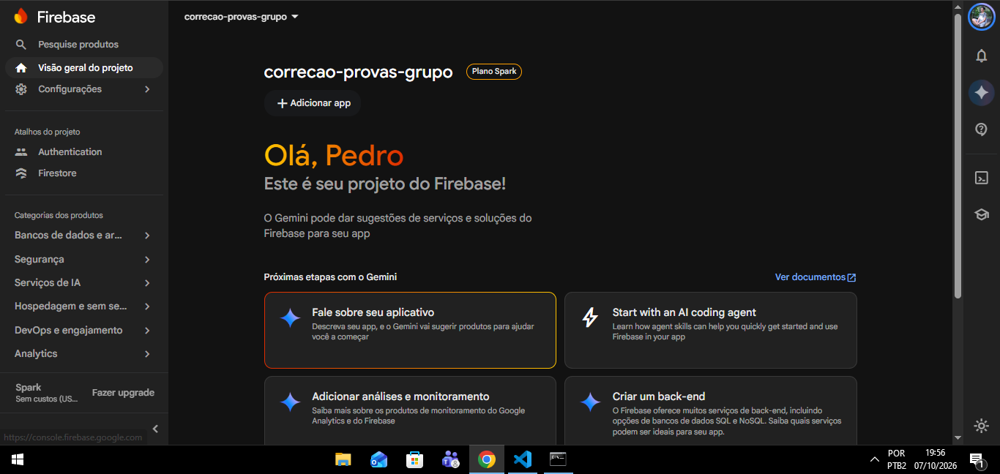
*Configuracao do Firebase no projeto Flutter.*

**Tambem neste dia - abertura da PR #16:**

- Criei o commit `6e86dcc` com a configuracao do Firebase e publiquei a
  branch `chore/configurar-firebase`.
- Abri a PR #16 contra `main` e solicitei revisao de `KelciaAntiuk`.
- A PR ficou aguardando aprovacao, sem incluir os arquivos sensiveis gerados
  pelo FlutterFire.

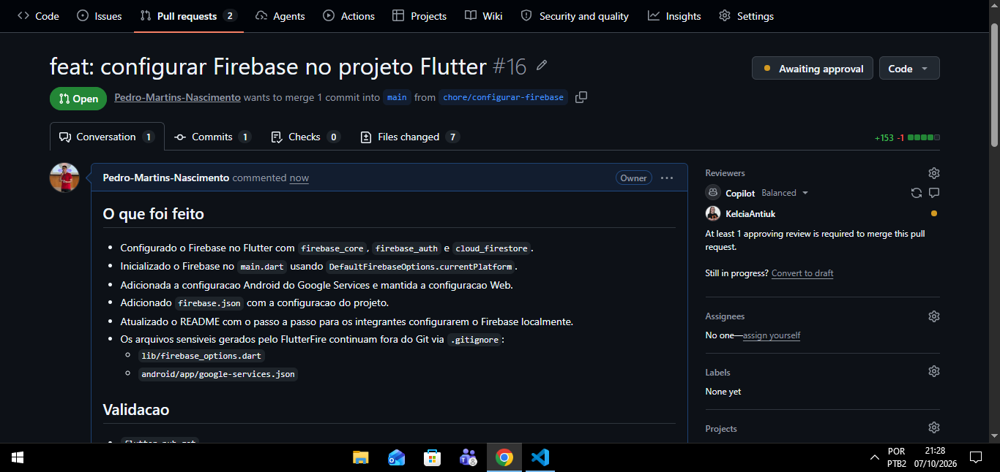
*PR #16 aberta no GitHub, aguardando aprovacao da revisora.*

---

## 09/10/2026

**O que foi feito:** aprovação e merge da PR #16 (`chore/configurar-firebase`), integrando a configuração base do Firebase na branch `main`.

**Como foi feito:**
- A revisora `KelciaAntiuk` concluiu a revisão técnica da PR #16 e aprovou as alterações.
- O merge foi realizado via squash (`gh pr merge --squash`), respeitando as rulesets do repositório.
- A branch `main` passou a conter a infraestrutura do Firebase inicializada no Flutter (`firebase_core`, `firebase_auth`, `cloud_firestore`), mantendo os arquivos sensíveis de credenciais devidamente ignorados pelo `.gitignore`.

**Resultado:** PR #16 mergeada na `main` com sucesso.

**Imagens:**

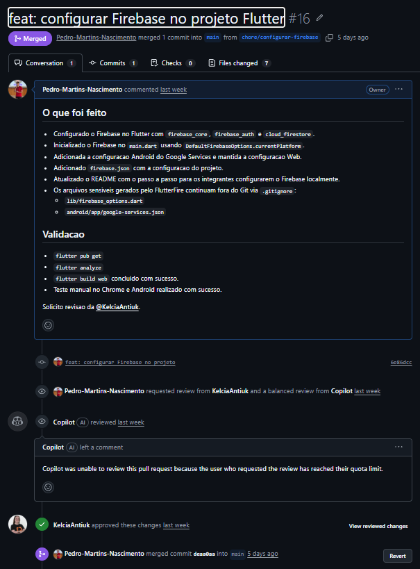
*Aprovação da PR #16 pela revisora e squash merge concluído na branch main.*

---

## 14/10/2026

**O que foi feito:** revisão, validação e merge das Pull Requests #17, #18 e #19 na sequência necessária para a entrega da N2 (persistência e autenticação com Firebase):
1. **PR #17** (`feature/n2-provas-firestore`, autora KarenAmancio): abstração de `ProvaRepository`, mapper e repositório em memória para provas e versões.
2. **PR #18** (`feat/firestore-security-rules`, autora KelciaAntiuk): regras de segurança do Firestore, injeção de dependência com `Provider` em todas as telas e repositórios de Turmas e Questões.
3. **PR #19** (`feat/login-firebase-auth`, autora KelciaAntiuk): autenticação via Firebase Auth, proteção de rotas no roteador, botão de logout e testes unitários.

**Como foi feito:**

- **Revisão e merge da PR #17 (`feature/n2-provas-firestore`):**
  - Avaliada a criação da interface `ProvaRepository` e sua implementação `ProvaRepositoryMemoria`.
  - Verificada a arquitetura da coleção no Firestore: `professores/{uid}/provas/{provaId}` com subcoleção `versoes` (estratégia que contorna o limite de 1 MiB por documento para provas com muitas versões).
  - Verificados testes unitários e mapeamentos em `test/prova_mapper_test.dart` e `lib/services/prova_mapper.dart`.
  - Executados `flutter analyze` e `flutter test` com sucesso.
  - Aprovada a PR e realizado o squash merge na `main`.

- **Revisão e merge da PR #18 (`feat/firestore-security-rules`):**
  - Avaliadas as regras de segurança em `firestore.rules` garantindo que cada professor acesse apenas os seus próprios dados (`request.auth.uid == userId`).
  - Adicionado o pacote `provider` ao `pubspec.yaml` e atualizado `lib/main.dart` com `MultiProvider` para gerenciar os estados de `TurmasRepository`, `QuestoesRepository` e `ProvaRepositoryMemoria`.
  - Refatoração das telas de Turmas, Questões, Provas, Início e Correção para consumir os repositórios injetados via `Provider`.
  - Validados os testes em `test/repositorios_test.dart`.
  - Executados `flutter analyze` e `flutter test`.
  - Aprovada a PR e realizado o squash merge na `main`.

- **Revisão, apontamento e resolução da PR #19 (`feat/login-firebase-auth`):**
  - **Revisão inicial e apontamento de pendências:** Na primeira análise da PR #19, solicitei alterações (*changes requested*) pontuando dois itens críticos:
    1. *Resolução de conflito com a `main`*: após o merge da #18, surgiram divergências em `lib/main.dart`, `lib/screens/inicio/inicio_screen.dart` e `pubspec.lock`. Forneci o passo a passo exato via git para manter as rotas protegidas e a injeção do `AuthService` com o `pubspec.lock` atualizado.
    2. *Remoção do botão "Entrar com Google"*: o provedor Google não estava ativo no console nem com SHA-1 configurado, o que causaria exceção em tempo de execução. Foi orientado focar na autenticação via e-mail e senha.
  - **Correções aplicadas pela autora:** A autora realizou o merge da `main` atualizada na branch `feat/login-firebase-auth`, ajustou as dependências e garantiu os mocks do `FirebaseAuth` para testes.
  - **Validação final:** Com as pendências resolvidas, realizei nova rodada de testes:
    - `flutter analyze` finalizado sem apontamentos.
    - `flutter test` concluído com todos os 32 testes passando (incluindo `test/auth_test.dart`).
  - **Aprovação e merge:** Registrei o review formal aprovando a PR e o merge foi concluído com sucesso.

**Resultado:**
- A branch `main` agora conta com o ciclo completo de autenticação e persistência:
  - Rotas protegidas exigindo login via `AuthService`.
  - Todas as telas integradas com injeção de dependência (`Provider`).
  - Regras de segurança do Firestore prontas e validadas para produção.
  - Todos os testes de unidade e integração automatizados passando com cobertura de autenticação e repositórios.

**Imagens:**

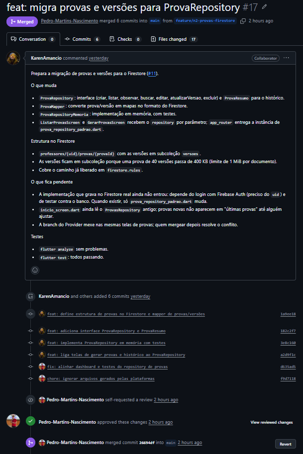
*Aprovação e merge da PR #17 (migração de provas para ProvaRepository).*

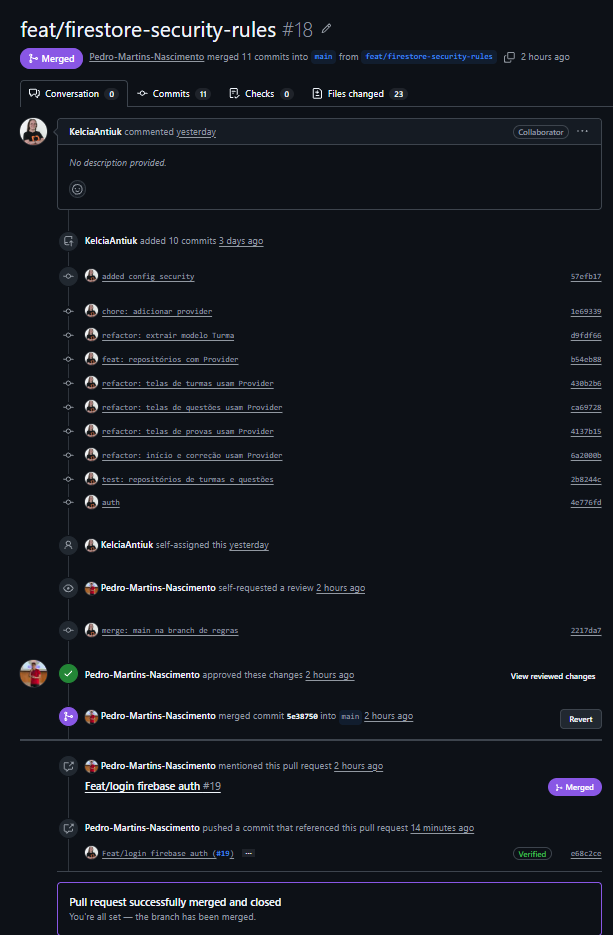
*Aprovação e merge da PR #18 (regras de segurança Firestore e migração para Provider).*

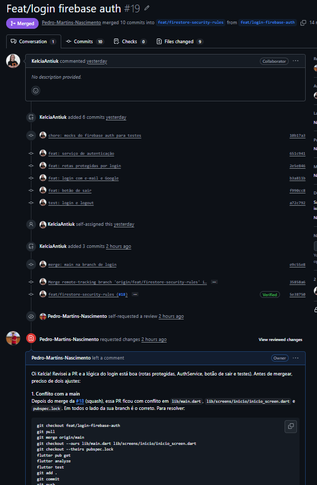
*Revisão inicial com solicitação de alterações (changes requested) e orientações técnicas para resolução de conflitos na PR #19.*

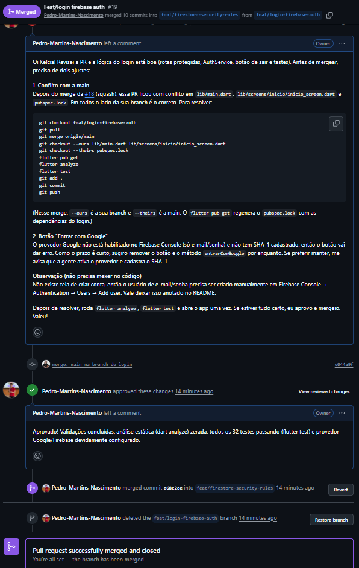
*Aprovação final e merge da PR #19 após validação com 32 testes passando.*

---

## 15/10/2026 — PR #20

**O que foi feito:** aplicação e publicação das regras de segurança do Firestore (*Security Rules*) no Firebase Console e aprovação/merge da PR #20 (`feat/firestore-security-rules`, autora KelciaAntiuk).

**Como foi feito:**
- Verificadas as regras de segurança desenvolvidas para o Firestore (`firestore.rules`), garantindo o isolamento dos dados por professor (`request.auth.uid == userId`).
- Publicadas as regras diretamente no Firebase Console para garantir a segurança dos acessos no ambiente de desenvolvimento/produção.

**Resultado:** regras de segurança ativas e aplicadas com sucesso no Firebase.

**Imagens:**

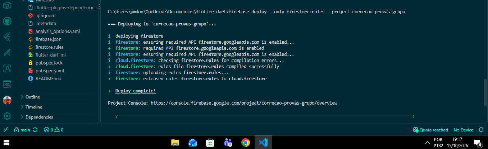
*Aplicação e publicação das regras de segurança do Firestore no Firebase Console.*

---

## 17/10/2026

**O que foi feito:** revisão, aprovação e merge das Pull Requests #21, #24, #22 e #23 na branch `main`, além de revisão técnica com solicitação de alterações (*changes requested*) e orientações na PR #25:
1. **PR #21** (`feat/correcoes-firestore`, autor Eduardoszz): persistência de correções, resultados e estatísticas no Firestore (mergeada).
2. **PR #24** (`feature/n2-provas-firestore-real`, autora KarenAmancio): implementação real do repositório de provas gravando no Firestore (`ProvaRepositoryFirestore`) (mergeada).
3. **PR #22** (`feature/n2-pdf-firestore`, autora KarenAmancio): desacoplamento de mocks no PDF e editor de layout, passando dados de prova e alunos por parâmetro e suporte a carregamento por `provaId` (mergeada).
4. **PR #23** (`feature/n2-relatorio-excel`, autora KarenAmancio): exportação de relatório de notas em formato de planilha Excel (`.xlsx`) (mergeada).
5. **PR #25** (`Feature/migração turmas-alunos`, autora leparpineli): migração de turmas e alunos para o Firestore (revisada com apontamentos e orientações de cherry-pick).

**Como foi feito:**

- **Revisão e merge da PR #21 (`feat/correcoes-firestore`):**
  - Avaliada a implementação do contrato `CorrecaoRepository` com implementações em memória e Firestore (`professores/{uid}/correcoes/{id}`).
  - Verificados os componentes `CorrecaoMapper` e `EstatisticaService`.
  - Validados os testes de contrato rodando em ambas as implementações via `fake_cloud_firestore`.
  - Aprovada a PR (`Pedro-Martins-Nascimento`) e realizado o squash merge do commit `23b6d63` na branch `main`.

- **Revisão e merge da PR #24 (`feature/n2-provas-firestore-real`):**
  - Avaliada a implementação de `ProvaRepositoryFirestore` substituindo a instância temporária em memória (`ProvaRepositoryMemoria`) que era usada na N1/início da N2.
  - A persistência grava os dados no caminho `professores/{uid}/provas/{provaId}`, salvando as versões na subcoleção `versoes` (com o campo `ordem` para manter a ordenação sequencial `v1, v2, ..., v10`).
  - Atualizado `MyApp` para receber o repositório do Firestore com o `uid` do professor autenticado e repassar ao `criarRouter`.
  - Removido `prova_repository_padrao.dart` e ajustado `test/auth_test.dart` para utilizar o repositório em memória nos testes.
  - Validação de testes: `flutter analyze` sem problemas e suite de testes `flutter test` passando.
  - Aprovada a PR (`Pedro-Martins-Nascimento`) e realizado o squash merge na branch `main`.

- **Revisão e merge da PR #22 (`feature/n2-pdf-firestore`):**
  - Adaptação do `PdfService` (`gerarPdfVersao` e `gerarPdfProvas`) para receber a lista de alunos por parâmetro em vez de ler internamente de `alunosMock`.
  - Evolução de `PreviewLayoutScreen` para receber `PreviewLayoutArgs` (versões e alunos) e inclusão do construtor nomeado `PreviewLayoutScreen.deProva`, permitindo carregar os dados diretamente via `ProvaRepository` caso o usuário acesse ou recarregue a página com `?provaId=`, exibindo feedback de carregamento ou "Prova não encontrada.".
  - Atualização de `GerarProvasScreen` para repassar os alunos da turma ao exportar PDF ou abrir o editor de layout, enviando o `provaId` na rota caso a prova já esteja salva.
  - Implementação do helper `alunos_para_pdf.dart` que busca os alunos da turma a partir do `TurmasRepository` (mantendo fallback para dados de teste caso a turma não possua alunos).
  - Atualização das rotas no `app_router.dart` para suportar argumentos ou query parameter `?provaId=`.
  - Aprovada a PR (`Pedro-Martins-Nascimento`) e realizado o squash merge do commit `cc3fc16` na branch `main`.

- **Revisão e merge da PR #23 (`feature/n2-relatorio-excel`):**
  - Avaliada a criação do modelo `LinhaNota` (aluno, prova e nota, tratando nota ausente como célula vazia em vez de zero).
  - Implementação da função `gerarXlsxNotas(linhas)`, retornando os bytes em formato `.xlsx` estruturados com aba "Notas" e cabeçalho estilizado em negrito, desacoplada da camada de apresentação ou compartilhamento de arquivos.
  - Validação de qualidade: `flutter analyze` sem problemas e suite `flutter test` passando com 5 novos testes unitários que geram e decodificam o `.xlsx` para validação da integridade dos dados.
  - Aprovada a PR (`Pedro-Martins-Nascimento`) e realizado o squash merge na branch `main`.

- **Revisão e orientação na PR #25 (`Feature/migração turmas-alunos`):**
  - Analisei o código da migração: a lógica de salvar na coleção `professores/{uid}/turmas` está correta e atende às regras do Firestore, mantendo `TurmasRepository()` compatível com `main.dart`.
  - **Identificação do problema:** a branch partiu de um ponto antigo e trouxe commits legados de login e security rules (de 12 a 15/10) que a `main` já absorveu via squash. Isso gerou conflito em `main.dart`, `app_router.dart`, `pubspec.lock`, `pubspec.yaml` e `test/auth_test.dart`.
  - Como o trabalho autêntico da autora altera somente 2 arquivos (`turma_mapper.dart` e `turmas_repository.dart` no commit `e63a8b1`), deixei comentário na PR com *Changes requested* sugerindo o fluxo mais limpo via `git cherry-pick e63a8b1` a partir da `main` atualizada em uma nova branch (`feat/turmas-firestore`), além de verificar se o cadastro/importação de alunos também já está persistindo no Firestore.

**Resultado:** PRs #21, #24, #22 e #23 aprovadas e mergeadas na `main`. A PR #25 recebeu feedback detalhado e instruções passo a passo para rebase/cherry-pick limpo sem conflitos, aguardando os ajustes da autora para merge final.

**Imagens:**

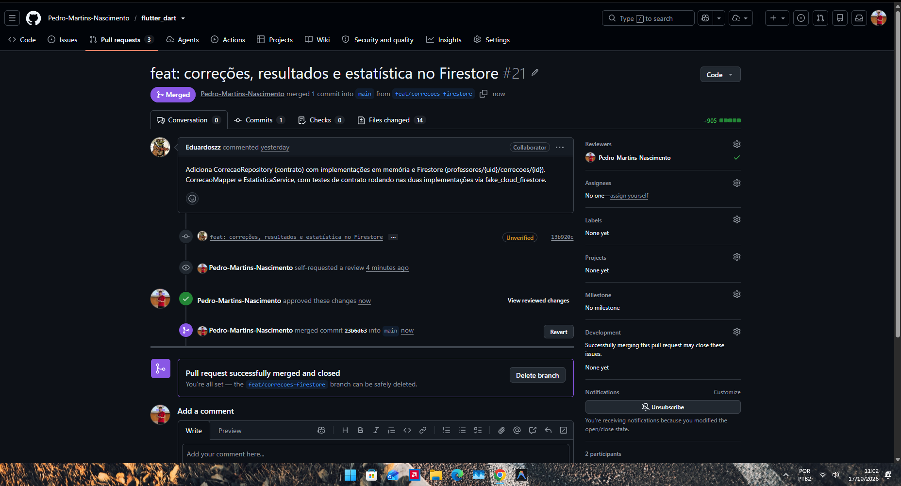
*Aprovação e merge da PR #21 (correções, resultados e estatística no Firestore).*

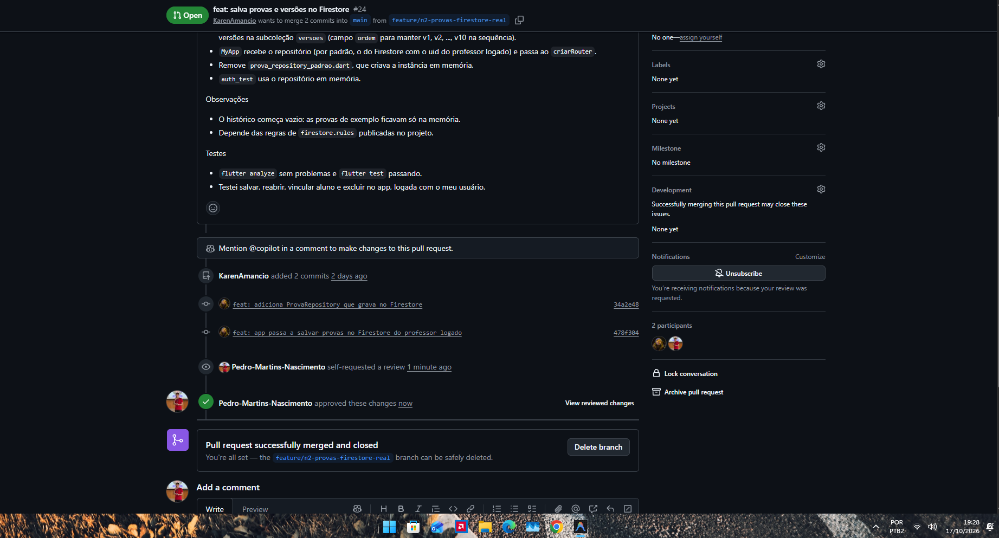
*Aprovação e merge da PR #24 (persistência real de provas e versões no Firestore).*

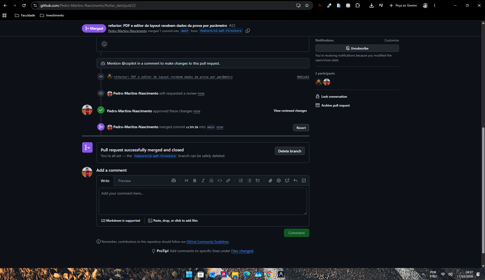
*Aprovação e merge da PR #22 (PDF e editor de layout recebendo dados por parâmetro e provaId).*

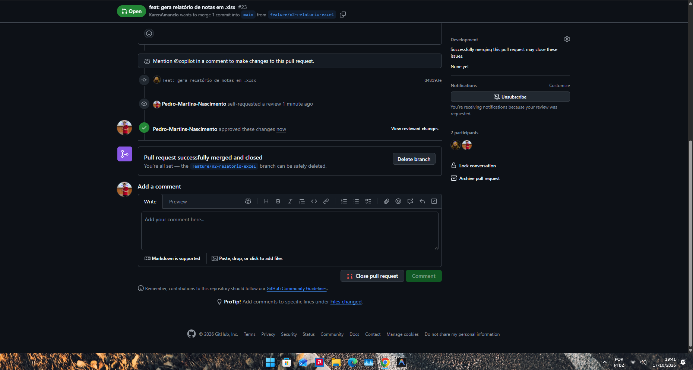
*Aprovação e merge da PR #23 (geração de relatório de notas em .xlsx).*

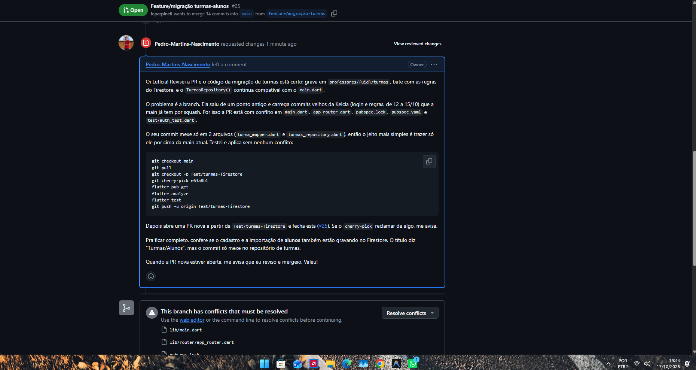
*Revisão técnica com solicitação de alterações (changes requested) e passo a passo de cherry-pick na PR #25.*

---

## 23/10/2026

**O que foi feito:** aprovação e merge da PR #26 (`feat/turmas-firestore`, autora leparpineli): correção do fluxo de importação e adição de alunos e ajuste do router, encerrando o ciclo aberto pela PR #25 (que havia recebido *changes requested* em 17/10 por conflitos gerados de commits legados já absorvidos pela `main`).

**Como foi feito:**
- A autora aplicou as orientações de cherry-pick deixadas no comentário da PR #25: rebaseou o trabalho autêntico (arquivos `turma_mapper.dart` e `turmas_repository.dart`) a partir da `main` atualizada, na nova branch `feat/turmas-firestore`, eliminando os commits legados de login e security rules que haviam causado os conflitos.
- Revisei a PR #26 resultante: importação/adição de alunos ajustada e router corrigido, sem conflitos com a `main` atual.
- Rodei `flutter analyze` (sem apontamentos) e os testes passaram — confirmado no comentário de aprovação registrado na PR.
- Aprovei a PR (`Pedro-Martins-Nascimento`) com o registro da validação no corpo e realizei o squash merge do commit `c6ff723` na branch `main`.

**Resultado:** PR #26 mergeada na `main` (squash). O fluxo de importação e adição de alunos às turmas está corrigido e persistindo no Firestore, com router ajustado e análise estática passando.

**Imagens:**

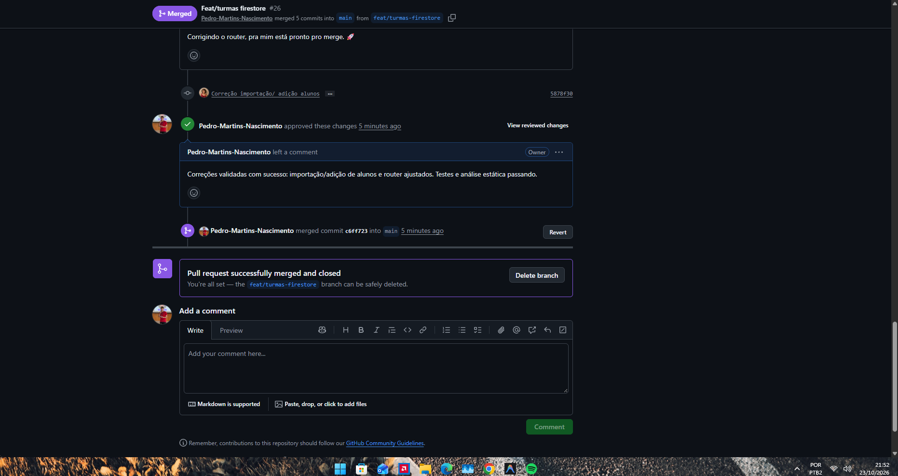
*Aprovação e squash merge da PR #26 (correção importação/adição de alunos e router) na branch main.*

---

## 23/10/2026 — PR #27

**O que foi feito:** revisão, aprovação e merge da PR #27 (`fix/router-prova-repository`, autora KarenAmancio): correção pontual na rota do editor de layout, que não estava utilizando o repositório de provas recebido pelo router.

**Como foi feito:**
- Revisei a PR #27 (`fix: rota do editor de layout usa o repositório recebido pelo router` → `main`): 1 arquivo alterado, sem conflito com a `main` atual.
- A correção garante que a rota do editor de layout (`PreviewLayoutScreen`) passa e consome o `ProvaRepository` injetado pelo router, eliminando a dependência direta de uma instância interna que não refletia o estado correto das provas persistidas no Firestore.
- Aprovei a PR (`Pedro-Martins-Nascimento`) com o comentário "Aprovado: rota do editor de layout corrigida." e realizei o squash merge na branch `main`.

**Resultado:** PR #27 mergeada na `main` (squash). O editor de layout agora opera sempre com o repositório correto fornecido pelo router, fechando a inconsistência de estado introduzida pela integração real com o Firestore.

**Imagens:**

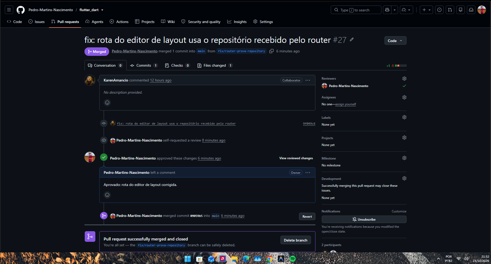
*Aprovação e squash merge da PR #27 (fix: rota do editor de layout usa o repositório recebido pelo router).*

---

## 23/10/2026 — PR #28

**O que foi feito:** revisão, aprovação e merge da PR #28 (`test/n2-prova-repository-firestore`, autora KarenAmancio): testes do `ProvaRepository` na implementação real do Firestore e correção no editor de layout (editar prova não apagava versões que continuam existindo).

**Como foi feito:**
- Revisei a PR #28 (`test: cobre o ProvaRepository do Firestore e corrige o editor` → `main`): 4 commits, 6 arquivos alterados (+288 / -162).
- Os 4 commits entregues:
  1. `fix: rota do editor de layout usa o repositório recebido pelo router` (`9f049c6`) — complementar ao fix da PR #27.
  2. `fix: editar prova no Firestore não apaga as versões que continuam` (`d214f01`) — correção de bug real na persistência.
  3. `test: roda os mesmos testes do ProvaRepository na versão do Firestore` (`9450607`) — suite de testes de contrato validando a implementação real.
  4. `test: editor de layout aberto só com o id da prova` (`f339957`) — teste de carregamento da tela por `provaId`.
- Validados os testes e análise estática antes de aprovar.
- Aprovei a PR (`Pedro-Martins-Nascimento`) com o comentário "Aprovado: testes de ProvaRepository no Firestore e correção no editar." e realizei o squash merge (4 commits) na branch `main`.

**Resultado:** PR #28 mergeada na `main` (squash). O repositório de provas do Firestore passou a ter cobertura de testes de contrato equivalente à implementação em memória, e o bug de apagar versões ao editar uma prova foi corrigido.

**Imagens:**

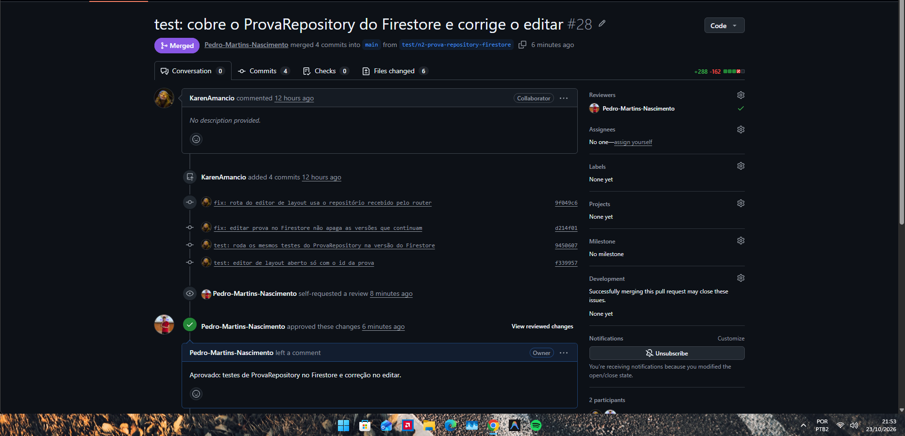
*Aprovação e squash merge da PR #28 (testes do ProvaRepository no Firestore e correção no editor de layout).*

---

## 23/10/2026 — PR #29

**O que foi feito:** revisão, aprovação e merge da PR #29 (`feature/n2-exportar-notas`, autora KarenAmancio): integração completa da exportação de notas da prova em Excel (`.xlsx`) pelo histórico de provas, fechando o passo 3 da PR #13.

**Como foi feito:**
- Revisei a PR #29 (`Feature/n2 exportar notas` → `main`): 4 commits, 8 arquivos alterados (+469 / -14).
- Os 4 commits entregues:
  1. `fix: rota do editor de layout usa o repositório recebido pelo router` (`df529f4`) — fix complementar (mesmo padrão das PRs #27 e #28).
  2. `feat: monta as linhas do relatório de notas a partir das correções` (`5723e23`) — monta `List<LinhaNota>` a partir das correções armazenadas no Firestore.
  3. `feat: salva a planilha de notas pelo seletor de arquivos` (`9439f33`) — usa o seletor nativo de arquivos para escolher onde salvar o `.xlsx`.
  4. `feat: exporta as notas da prova em Excel pelo histórico` (`95f022d`) — botão de exportação integrado à tela de histórico de provas, ligando o relatório Excel ao app.
- A autora descreveu a PR como "Fecha o passo 3 da #13: liga o relatório em Excel ao app."
- Validados os testes e análise estática antes de aprovar.
- Aprovei a PR (`Pedro-Martins-Nascimento`) com o comentário "Aprovado: exportação de notas da prova em Excel pelo histórico." e realizei o squash merge (4 commits) na branch `main`.

**Resultado:** PR #29 mergeada na `main` (squash). O fluxo de exportação de notas em `.xlsx` está completo e integrado ao histórico de provas: o professor acessa o histórico, seleciona uma prova e exporta a planilha de notas diretamente para o dispositivo.

**Imagens:**

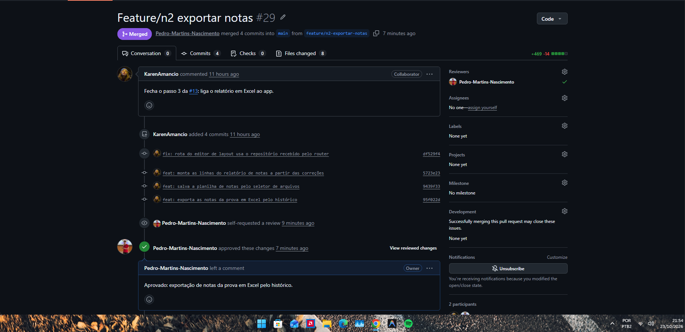
*Aprovação e squash merge da PR #29 (exportação de notas da prova em Excel pelo histórico).*

---

## 24/10/2026 — PR #30

**O que foi feito:** desenvolvimento, testes, aprovação e merge da PR #30 (`feat/questoes-firestore`, autor Pedro-Martins-Nascimento): migração completa do banco de questões para o Cloud Firestore com suporte a tempo real, serialização com mapper, tratamento de estado vazio e testes unitários.

**Como foi feito:**
- Criei a branch `feat/questoes-firestore` a partir da `main` atualizada e implementei a persistência no Firestore:
  1. `feat: adiciona QuestaoMapper para serializacao no Firestore` (`7b3a4af`): criação do mapper para conversão entre o modelo `Questao` e os documentos do Firestore (`toMap`/`fromMap`).
  2. `feat: migra QuestoesRepository para o Firestore com suporte a tempo real` (`d9f635b`): migração da camada de dados para gravar e consultar na coleção de questões sob o escopo do professor autenticado (`professores/{uid}/questoes`), com atualização reativa em tempo real via streams do Firestore.
  3. `feat: adiciona estado vazio para lista de materias` (`91bf78e`): melhoria na interface para exibir mensagem informativa e amigável quando não houver matérias ou questões cadastradas.
  4. `test: adiciona testes unitarios do QuestoesRepository no Firestore` (`1a67c2e`): cobertura de testes unitários automatizados validando operações de CRUD no repositório.
- Checklist e validações cumpridas:
  - `flutter analyze` finalizado sem apontamentos.
  - `flutter test` passando 100%.
  - Remoção dos dados mock: com a transição para o banco real, as 48 questões mockadas deixaram de ser carregadas por padrão, passando a exibir o estado vazio até que novas questões sejam cadastradas.
- Abri a PR #30, atribuí a revisão para `KelciaAntiuk` que avaliou e aprovou as alterações.
- Realizei o squash merge do commit `ccb06b1` na branch `main`.

**Resultado:** PR #30 aprovada e mergeada na `main` com sucesso. O módulo de questões agora opera 100% integrado ao Firebase Firestore, isolado por professor, com reatividade em tempo real e testes unitários garantindo a estabilidade.

**Imagens:**

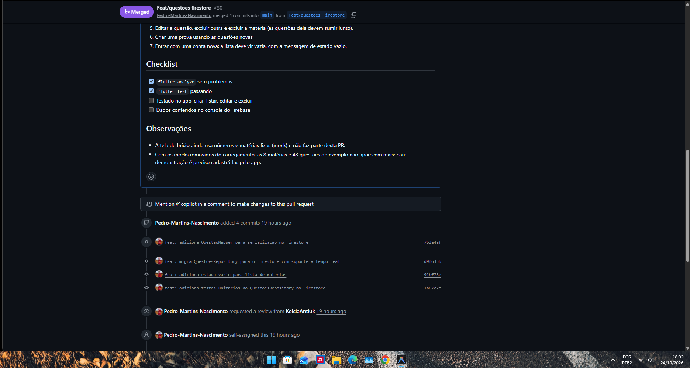
*Commits da PR #30, checklist de validação e notas sobre a migração de mocks para Firestore.*

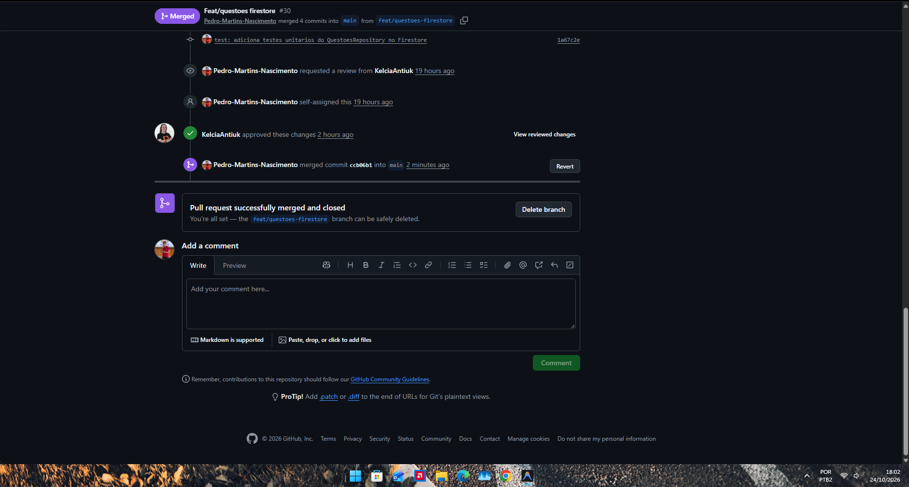
*Aprovação da revisora KelciaAntiuk e squash merge da PR #30 na branch main.*

---

## 25/10/2026 — PR #32

**O que foi feito:** revisão, aprovação e merge da PR #32 (`feature/n2-boletim-estatistica`, autora KarenAmancio): implementação da geração de boletim em PDF (individual por aluno e em lote para todos os corrigidos) e criação da tela analítica de estatísticas da turma.

**Como foi feito:**
- Revisei a PR #32 (`Feature/n2 boletim estatistica` → `main`): 2 commits, 8 arquivos alterados (+545 / -46).
- Os 2 commits entregues:
  1. `feat: boletim em PDF do aluno e de todos os corrigidos` (`0d6cd85`): serviço de geração de boletim de desempenho individual em PDF para o aluno e funcionalidade de exportação em lote de todos os boletins dos alunos com avaliações corrigidas.
  2. `feat: tela de estatistica completa da turma` (`93e2a6c`): tela dedicada com métricas e visualização estatística completa da turma (distribuição de notas, médias e aproveitamento) a partir dos dados do Firestore.
- Validação técnica e testes concluídos sem apontamentos.
- Aprovei formalmente a PR (`Pedro-Martins-Nascimento`) com o comentário "LGTM" e realizei o squash merge do commit `b65a230` na branch `main`.

**Resultado:** PR #32 mergeada na `main` (squash). O sistema agora oferece relatórios em PDF individuais e consolidados de desempenho dos alunos (boletins), além de uma visão analítica detalhada com estatísticas de aproveitamento por turma.

**Imagens:**

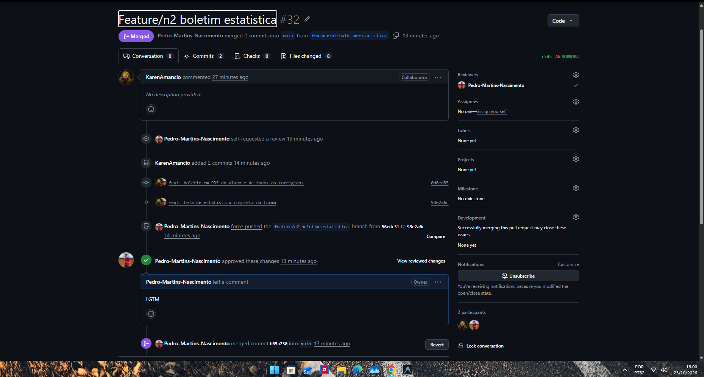
*Aprovação e squash merge da PR #32 (boletim em PDF e tela de estatísticas da turma).*

---

## 25/10/2026 — PR #33

**O que foi feito:** revisão, aprovação e merge da PR #33 (`feature/n2-correcao-resultados`, autora KarenAmancio): fluxo completo de correção de provas via QR Code, cálculo de pontuação, persistência no Firestore e atualização do dashboard de Início com métricas em tempo real.

**Como foi feito:**
- Revisei a PR #33 (`Feature/n2 correcao resultados` → `main`): 6 commits, 15 arquivos alterados (+1.020 / -77).
- Principais entregas da PR:
  1. `feat: acha a versão da prova pelo QR lido na folha` (`6b901f2`): decodificação dinâmica da versão e gabarito da avaliação a partir do payload do QR Code lido pela câmera.
  2. `feat: repositório de correções do professor logado` (`9f76290`): persistência no Firestore sob a coleção do professor (`professores/{uid}/correcoes`).
  3. `feat: telas de resultado e de histórico das correções` (`4e0645f`): interface com o detalhamento das respostas corrigidas e listagem cronológica do histórico de correções.
  4. `feat: corrige a folha lida pelo QR e salva a nota no Firestore` (`eb5b1c3`): processamento automático de acertos/erros e gravação do resultado.
  5. `feat: Início mostra corrigidas, pendentes, média e erro por matéria` (`e15d1fb`): conexão das métricas do repositório de correções com o painel da tela inicial.
- Validação técnica e testes executados com sucesso.
- Aprovei formalmente a PR (`Pedro-Martins-Nascimento`) com o comentário "LGTM" e realizei o squash merge do commit `35de8ea` na branch `main`.

**Resultado:** PR #33 mergeada na `main` (squash). A funcionalidade central de correção automatizada por câmera/QR Code está plenamente integrada ao Firestore, alimentando os dados da tela inicial e o histórico de avaliações.

**Imagens:**

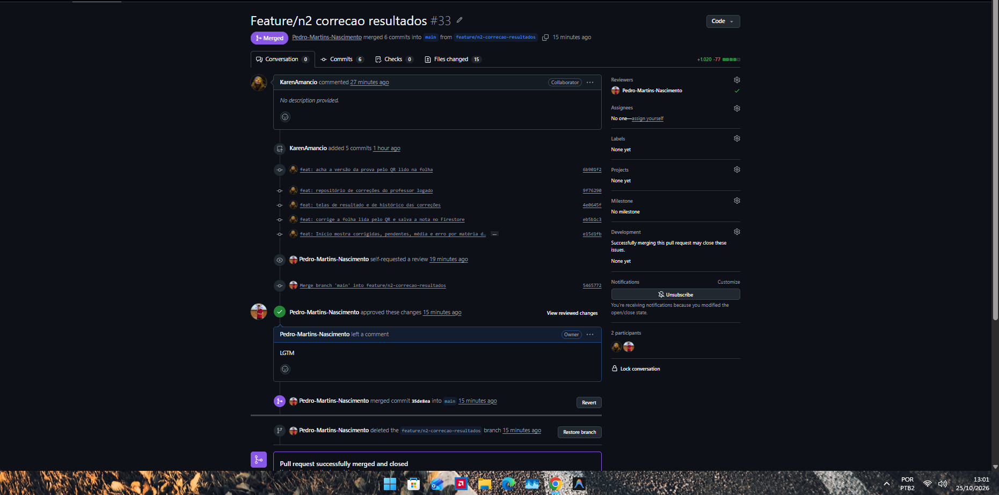
*Aprovação e squash merge da PR #33 (fluxo de correção por QR Code, resultados e integração com o dashboard).*

---

## 25/10/2026 — PR #34

**O que foi feito:** revisão, aprovação e merge da PR #34 (`feature/n2-selo-pendentes`, autora KarenAmancio): inclusão do selo indicador de provas pendentes de correção na aba "Corrigir".

**Como foi feito:**
- Revisei a PR #34 (`Feature/n2 selo pendentes` → `main`): 1 commit, 6 arquivos alterados (+198 / -18).
- Commit entregue: `feat: selo de pendentes na aba Corrigir` (`af926c7`), criando um badge visual que computa e sinaliza em destaque a quantidade de provas que ainda aguardam leitura e correção.
- Validados os testes e a consistência visual da interface.
- Aprovei formalmente a PR (`Pedro-Martins-Nascimento`) com o comentário "LGTM" e realizei o squash merge do commit `cb98337` na branch `main`.

**Resultado:** PR #34 mergeada na `main` (squash). A aba Corrigir agora exibe feedback visual imediato sobre pendências de correção para o professor.

**Imagens:**

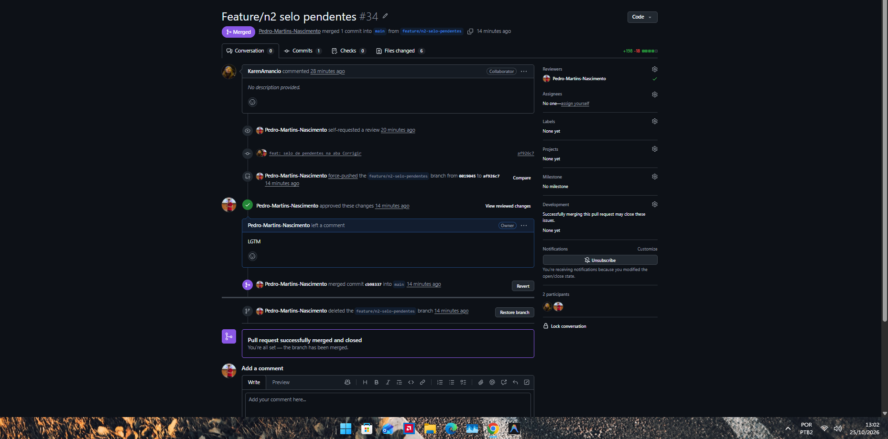
*Aprovação e squash merge da PR #34 (indicador/selo de pendências de correção na aba Corrigir).*

---

## 25/10/2026 — PR #35

**O que foi feito:** revisão, aprovação e merge da PR #35 (`fix/salvar-planilha-web`, autora KarenAmancio): ajuste no feedback de salvamento de relatório Excel no ambiente Web.

**Como foi feito:**
- Revisei a PR #35 (`fix: exportar notas no navegador mostra o aviso de planilha salva` → `main`): 2 commits, 1 arquivo alterado (+4 / -3).
- Commit entregue: `fix: exportar notas no navegador mostra o aviso de planilha salva` (`97432ad`), assegurando que a mensagem de confirmação (aviso de sucesso) seja acionada após o download da planilha pelo navegador.
- Validação executada no target Web.
- Aprovei formalmente a PR (`Pedro-Martins-Nascimento`) com o comentário "LGTM" e realizei o squash merge do commit `97a2e6f` na branch `main`.

**Resultado:** PR #35 mergeada na `main` (squash). O download de planilhas de notas na versão Web agora fornece o feedback visual adequado de conclusão da operação.

**Imagens:**

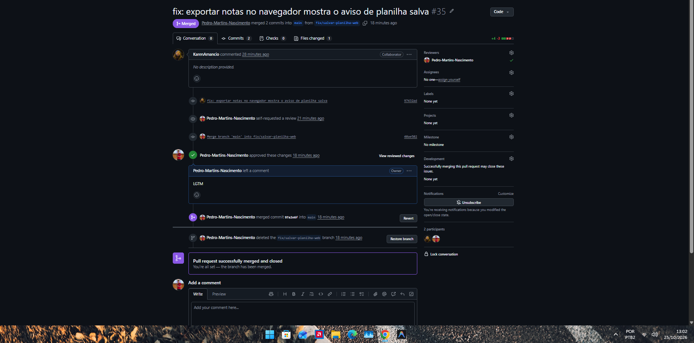
*Aprovação e squash merge da PR #35 (aviso de planilha salva no navegador ao exportar notas).*

---

## 27/10/2026 — PR #36

**O que foi feito:** revisão, aprovação e merge da PR #36 (`ajustes-erros-gerais`, autora KelciaAntiuk): ajustes gerais de autenticação com Google nativo no Android, eliminação completa de dados mock residuais (Início, Gerar Provas, Correção e exportação de alunos), retorno de instância na criação de matérias e documentação abrangente da entrega N2 no README do projeto.

**Como foi feito:**
- Revisei a PR #36 (`Ajustes erros gerais` → `main`): 6 commits, 13 arquivos alterados (+264 / -138).
- Os 6 commits entregues:
  1. `auth` (`22f62e3`): adição da dependência `google_sign_in: ^7.2.0` e implementação do login nativo com Google no Android via `GoogleSignIn.instance.initialize(serverClientId: ...)` e `authenticate()`, evitando que no Android a autenticação passe pelo navegador e perca o estado da sessão ao usar navegadores alternativos, além de tratar cancelamento pelo usuário e exceções específicas.
  2. `auth` (`aa9fa88`): ajustes no fluxo de logout (`GoogleSignIn.instance.signOut()`) para garantir que o próximo login não reutilize a mesma conta automaticamente sem perguntar ao usuário.
  3. `remove mock` (`bdf25bd`): remoção de dados mockados em `InicioScreen` (tratamento de lista vazia com mensagem "Nenhuma prova gerada ainda." em vez de exibir provas fictícias de `_provasMock`), em `GerarProvasScreen` (turma vazia não injeta mais `alunosMock`) e em `alunos_para_pdf.dart` (retorna lista vazia em vez de cair nos dados de teste).
  4. `testes` (`a222a54`): atualização dos testes unitários para refletir a remoção dos mocks (`test/alunos_para_pdf_test.dart`), injeção de função de token simulado nos testes de autenticação (`test/auth_test.dart`) e novo teste unitário em `test/repositorios_test.dart` validando retorno da matéria criada.
  5. `remove mock` (`fdfd565`): remoção do contador mock fixo `_jaCorrigidas = 12` na `CorrigirScreen`, substituído pelo cálculo real e reativo conectando streams de provas e correções com `contarPendentes(_provas, _correcoes)`, exibindo "Tudo corrigido" ao finalizar; ajuste em `QuestoesRepository.criarMateria` para retornar a `Materia` criada, permitindo seleção imediata da nova matéria em `CriarProvaScreen`.
  6. `update read me` (`5d62326`): reformulação do `README.md` do projeto `flutter_dart` para o escopo da entrega N2, atualizando o status de todos os requisitos (RF01 a RF15), o guia passo a passo de configuração do Firebase (`flutterfire configure`), o cadastro de chaves SHA-1 para login Google no Android (`firebase apps:android:sha:create`), o deploy de regras do Firestore e o processo de geração do APK de release.
- Validação técnica e testes unitários executados com sucesso (`flutter analyze` e `flutter test` passando 100%).
- Aprovei formalmente a PR (`Pedro-Martins-Nascimento`) e realizei o squash merge dos 6 commits (commit consolidado `43b66ea`) na branch `main`.

**Resultado:** PR #36 mergeada na `main` (squash). O aplicativo teve seus últimos dados mock eliminados, a autenticação Google nativa no Android estabilizada, a contagem de provas corrigidas corrigida para tempo real e a documentação técnica da entrega N2 completamente atualizada.

**Imagens:**

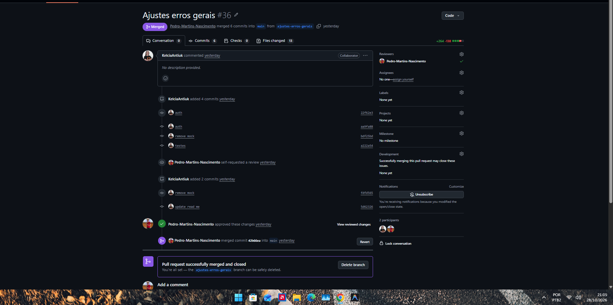
*Aprovação e squash merge da PR #36 (ajustes gerais de erros, remoção de mocks, auth Google e documentação N2).*

---

<!--
Modelo para novas entradas — copiar e preencher:

## DD/MM/AAAA

**O que foi feito:**

**Como foi feito:**

**Resultado:**

**Imagens:**
-->
